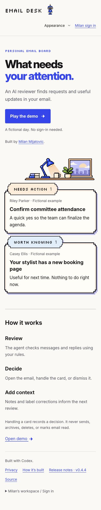
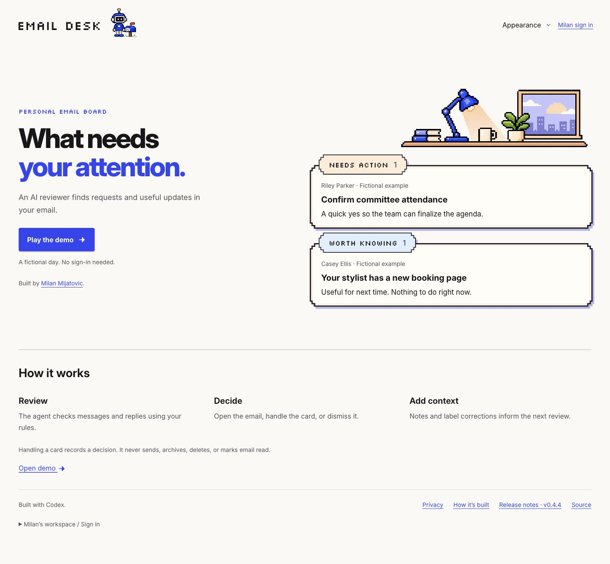
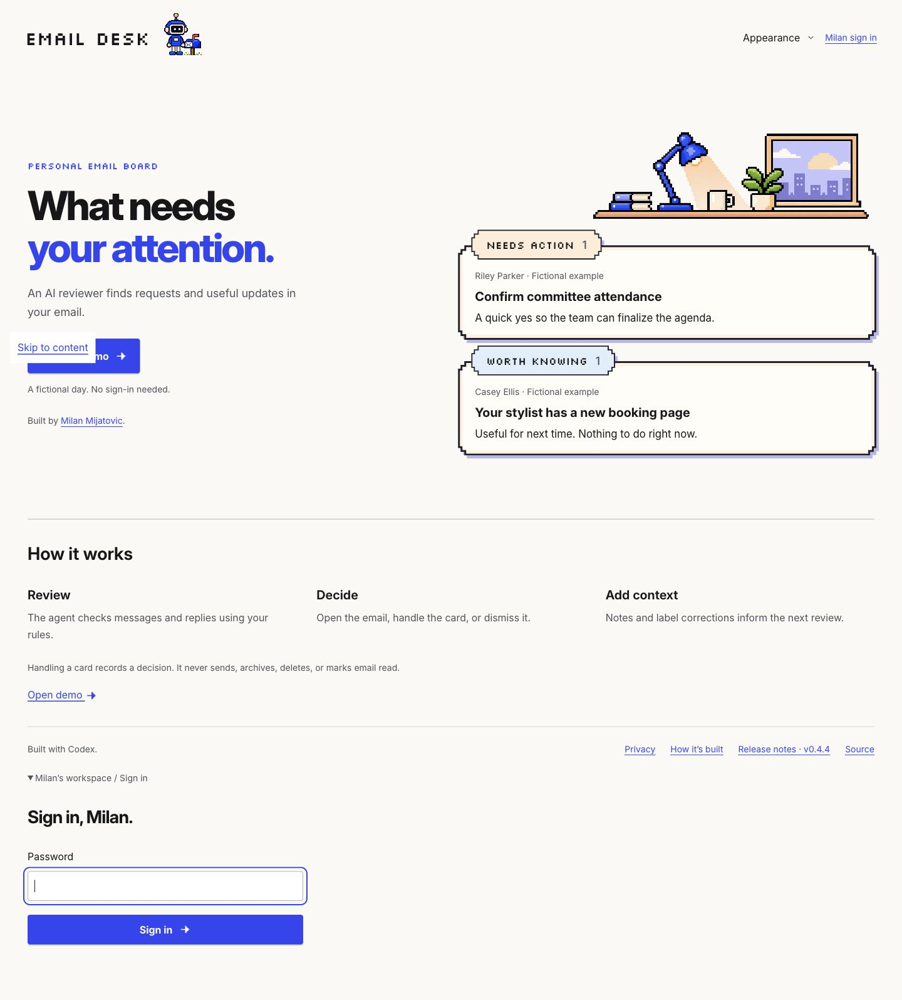
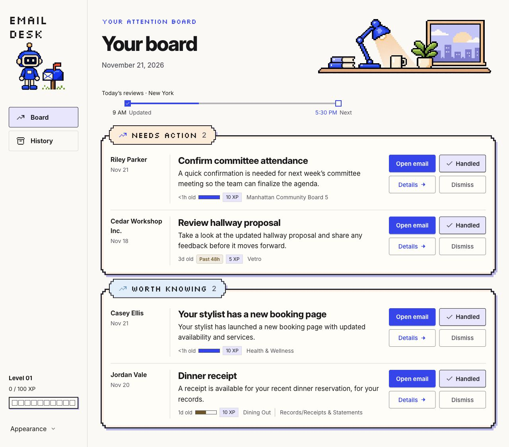
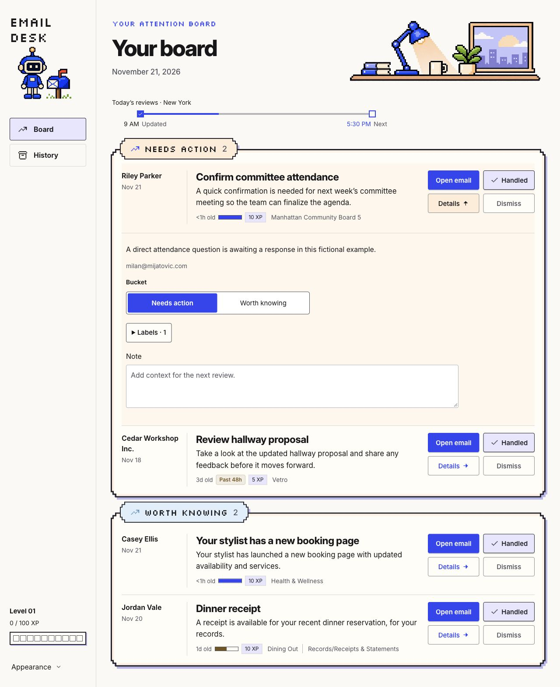
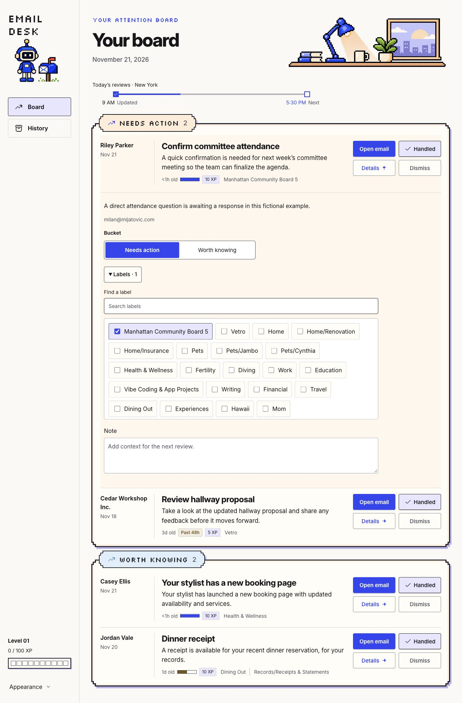
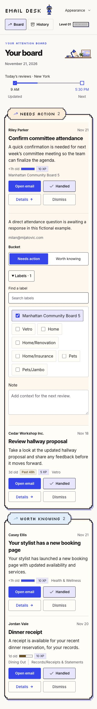
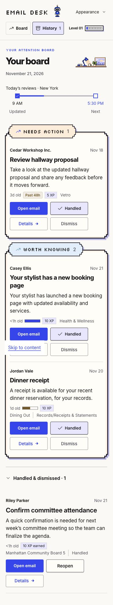
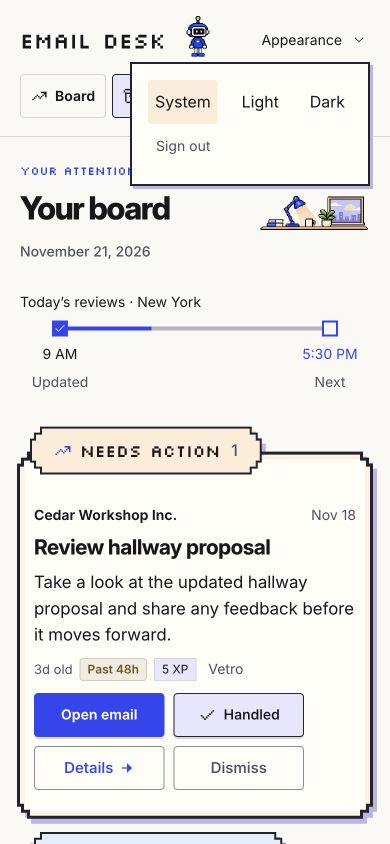
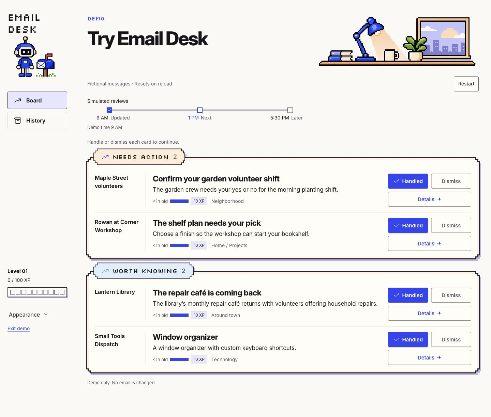

# Email Desk product review and improvement proposal

November 21, 2026. Original audit and proposal. Milan subsequently authorized implementation and production publication. See [the implementation record](PRODUCT_UPDATE_050.md) for delivered scope and verification; the findings below preserve the original review.

Email Desk's two-bucket board and visual identity are worth preserving. The hosted reviewer changes what the product needs to explain: whether recent mail was checked, what remains in historical catch-up, whether a scheduled run actually published, and what the API work costs. The most valuable next iteration makes those facts understandable and helps a growing board stay manageable.

## Scope and evidence

This review used the live v0.4.4 landing page, sign-in, authenticated board structure, public demo, and the existing fictional owner preview. Screenshots below were captured and inspected during this review. Owner screenshots were blocked by automatic approval review because they could expose private email and sensitive details; the signed-in visual examples therefore use fictional data. Live owner findings are read-only observations, not screenshot-backed visual findings. No real card decisions, feedback, Gmail changes, model requests, deployment or schedule changes were made.

The current master Google Doc was read successfully: Email Organization Playbook v1.1, November 15. It remains master. Its older operational statements about an unconfigured recurring reviewer predate the latest explicit approvals and November 21 activation records; reconciling those statements is a proposed documentation task, not permission to change rules or replace the master.

Architecture and feasibility were checked against `public/app.js`, `server/Store.php`, `reviewer/model.py`, `reviewer/engine.py`, `reviewer/state.py`, `scripts/reviewer-usage.py`, and the current README, handoff and reviewer contract. Findings below distinguish visible behavior, source-derived issues and proposals.

## Flow review

| Step | Surface and evidence | Health and finding |
| --- | --- | --- |
| 1 | Live landing, mobile | Good: clear promise, explicit fictional demo, readable stacking. Long page before the owner sign-in form. |
| 2 | Live landing, desktop | Good: distinctive pixel identity with readable body typography; examples explain the two buckets. Explain scheduled, context-driven review slightly more directly. |
| 3 | Live owner entry | Usable, with friction: the top sign-in link opens a form beneath the full landing page. A returning owner should reach a focused sign-in view. |
| 4 | Fictional signed-in board; live board structure read separately | Good foundation: recognizable actions and shared buckets. Growing volume makes retrieval and jumping between buckets more valuable. |
| 5 | Fictional expanded card | Usable: summary, reason, bucket, labels and note are present. Clarify why the card appeared and make feedback results available without hover. |
| 6 | Fictional label picker | Functional: existing search and checked labels should stay. A long, internally scrolling list increases effort; selected labels should be easier to review. |
| 7 | Fictional mobile expanded card | Readable reflow. A single expanded editor occupies several screens; provide a clear collapse path and keep save status near the edit. |
| 8 | Fictional decision and History | Decision moved to history and earned 10 XP. History navigation scrolls to a section below the active board, rather than opening a separate view. |
| 9 | Fictional Appearance menu | Themes are discoverable. Sign out is unexpectedly filed under Appearance. |
| 10 | Live public demo entry, desktop | Clear fictional boundary. Its opening instruction asks users to clear every card, which can obscure the context-feedback value and make exploration feel mandatory. Later demo stages were not replayed end to end. |

### Landing and owner entry

### Board and details with fictional data

### History and secondary navigation

The published evidence set contains only inspected public and fictional screenshots. Private email screenshots are excluded.

## Highest priority changes

### 1 Explain recent freshness separately from catch-up

The live board's headline says “Inbox review is incomplete.” Current activation evidence establishes both recent scans completed while historical catch-up remains partial. That broad headline gives insufficient help deciding whether today's board is trustworthy.

Use a compact status summary such as “Recent mail checked · Older mail still being reviewed,” only when structured evidence supports both claims. Expand to show each account's last verified coverage time, historical window/progress, last publication, next planned review, and any verification issue. Account details belong here rather than dominating the shared board.

Required foundation: publish typed per-account coverage and safe issue fields to the Store/API. The private worker journal contains more detail than the board currently receives. Do not parse the human summary to derive success, and do not calculate a completion percentage without a trustworthy denominator. Use “Reviewed through…” or a bounded date window instead.

Acceptance: recent-success/historical-partial, one-account failure, both-account failure, stale coverage, first review, delayed publication and board-fetch failure all have distinct truthful presentations. Failed-account checkpoints remain unchanged and saved cards remain available.

### 2 Make the review timeline represent the actual run

The live board attributes a later publication to the morning slot. Source inspection explains why: `reviewDay()` assigns results to the time interval in which they finished. That can make a manual validation or delayed recovery look like a scheduled review. The route itself measures elapsed time, which is another concept again.

Record scheduled slot, trigger type, start, finish and publication timestamps separately. Display “Published at…” independently from “Mail checked through…”. A manual run can establish freshness without retroactively satisfying a missed scheduled slot. A recovered scheduled run can retain its original slot while showing its actual publication time.

Keep the daily checkpoints compact. Put run details in System. Show “Hosted schedule active” as configuration status; reserve reliability claims for observed executions. First actual scheduled publication and Mac-offline acceptance remain pending in the current handoff.

Acceptance: manual, on-time, late, recovered, missed and failed runs are distinguishable; DST and weekend schedules retain New York time. Do not turn historical partial coverage into a successful review merely to show a check mark.

### 3 Help the larger board stay small in use

The live board now has substantially more cards than the four-card preview. With stacked buckets, Worth knowing and History can require a long journey down the page.

Start with quiet jump links for the two buckets and a genuine History view. Add History search first, with status/date refinement inside that view. Board search is a later option if normal use shows retrieval friction; it was deliberately removed in an earlier simplification and should not return as a large permanent toolbar. Keep accounts unified and any account filter secondary.

Do not hide older action cards or automatically dismiss awareness cards. Consider collapsible groups for repeated low-action updates only after validating their usefulness. Grouping needs stable membership, source links and clear decision semantics; a visual group must not silently close several cards.

Acceptance: a user can reach either bucket and find a prior decision without scrolling the whole active board. Search distinguishes no matches from an empty board, preserves drafts, and does not alter counts or card state invisibly.

## Suggested information architecture

| Location | Contents |
| --- | --- |
| Public home | Product promise, fictional preview, demo, concise process, privacy and build story. |
| Owner sign-in | Focused form with a clear route back to the public home. Keep authentication mandatory. |
| Board | Needs action and Worth knowing, compact review health, source links, decisions, context. |
| History | Handled/dismissed cards, search, decision date/status, retained context, Reopen. |
| System, secondary navigation | Review health and run history; API usage; feedback queue; playbook source/version. Start as one view with disclosures. |
| Appearance | System/light/dark only. Put Sign out in workspace/account controls. |

Preserve the robot, stepped bucket frames, cobalt accents, readable Inter text and restrained motion. There is no evidence here that a wholesale visual redesign would improve the core task.

## UI and copy refinements

| Change | Purpose and scope |
| --- | --- |
| Add one sentence about scheduled review to the landing process | Explain that the agent uses priorities, rules and later feedback at planned times. Avoid implying real-time monitoring, model-weight training, measured inbox peaks or guaranteed coverage. Keep the demo primary and avoid account-count marketing copy. |
| Keep the public project identity clear | Visitors should understand this is Milan's personal working app and demonstrator. Preserve build/source links; verify their anonymous accessibility before relying on them as public navigation. External destinations were not tested here. |
| Let the demo teach one complete loop early | Encourage opening Details, adding context and making a decision, then finding it in History. Explain advancing simulated reviews and offer an optional skip if pacing warrants it. Do not require closing every card to understand the product. |
| Rename “Bucket” to a task-facing label such as “Show in” | The two existing options already explain the choice. Keep native radio semantics. |
| Give the reason a short “Why this appeared” heading | Separate explanation from user notes and label editing. Add verified source/date context where available; avoid numerical confidence without calibration. |
| Put selected labels before the full list | Search already exists. Improve scanning with a selected summary and optional family grouping while preserving exact shared label names. Announce search result counts and checked state. |
| Make feedback explanations readable on touch | `feedback_explanation` currently appears as a title/hover attribute. Show a concise expandable result, processed time and a source link where appropriate. Saved locally, queued, context reviewed and Gmail-label verification mean different things. |
| Keep personal timing subordinate to real deadlines | “Past 48h” is a board target. Use “48h board target” in its explanation and present verified sender deadlines separately. Normalize date formatting without inventing missing dates. Retain the approved 10/5 XP policy. |
| Improve long mobile editing | Provide a clear close/collapse action after the editor and keep dirty/save status close to edited fields. Check nested label scrolling with touch and a software keyboard. Avoid adding a bottom action bar before proving it will not obscure content. |
| Clarify History navigation | Either make History a real view, as proposed, or label it as a jump. The current selected navigation state can suggest a page change while the full board stays above it. |

## Ancillary functions worth incorporating

### API usage and calculated cost

This is a strong fit for the hosted architecture. Start with a private, read-only Usage section inside System, rather than a spending widget on every board visit.

Show a selected date range, request count, input/output tokens, cached-read and cache-write breakdown when returned, calculated USD, last update time, and the model/rate snapshot used. Include paid incomplete responses and semantic-verification failures. Separate ordinary scheduled reviews, catch-up, manual validation, dry-runs and retries; “dry-run” describes lack of mailbox/board writes, not necessarily lack of model cost.

The encrypted worker journal already records usage by slot, model, response status, time and thread count. The existing `reviewer-usage.py` only reads local connectivity/pilot usage files; it is not a complete hosted usage dashboard. Build a safe aggregate projection from the hosted journal to an authenticated endpoint. Do not return raw journal data, request identifiers, prompts, email excerpts, grants or keys to the browser. Preserve deduplication across retries and uncertain acknowledgements; expose missing usage as unknown rather than zero. Some run-purpose categories will require additional explicit metadata.

Cost calculation should use non-overlapping token categories:

`calculated USD = (ordinary input × input rate + cached reads × cached rate + cache writes × write rate + output × output rate) / 1,000,000`

Subtract cache reads/writes from total input before pricing ordinary input. Do not add reasoning tokens again when they are included in output. Rates must be model-specific and versioned, with a checked date. Verify official pricing when implementing; this review establishes no current price quote.

The handoff's first 32 hosted requests total 379,721 input and 36,689 output tokens, calculated at $0.065807225 using the November 20 snapshot. That is historical setup/validation/recovery/catch-up measurement, not posted billing or a typical monthly operating rate. The $25 funding record does not establish today's remaining balance. Do not present “$25 minus our estimate” as an authoritative balance.

After a representative routine sample, add a clearly labelled forecast range using observed routine slot costs and the actual upcoming weekday/weekend schedule. Show sample size, period and exclusions; treat catch-up as a separate scenario. Suggested product gate: at least two routine weeks spanning weekdays/weekends and observed retry behavior, then review whether that sample is representative. This is a proposal, not a statistical guarantee.

Acceptance: cost reconciles to the included token records, missing usage is visible, category totals reconcile to the range total, rate changes retain historical calculations, and no private payload appears in responses or logs. No new paid requests are necessary to build the first reporting version.

### Other opportunities

| Function | Value | Priority and dependency |
| --- | --- | --- |
| Run history | Explain what ran, what published, covered-through times, retries and safe failure reasons. | High. Needs the structured status contract described above. Read-only first; opening the page must not trigger a run. |
| Feedback queue | Find pending/error corrections across cards, including cards already in History; distinguish recorded context from verified Gmail changes. | High. Existing feedback records support the concept; add a private owner-facing projection. Reuse scoped event IDs and revision controls. |
| Playbook provenance | Show master source, version/revision and last successful fetch used by a run. Detect a failed rule fetch without substituting a new master. | Medium. Requires run provenance metadata. Start with a link/read-only summary, not an in-app rule editor. |
| Changes since last visit | Identify newly added or materially changed cards and explicit reopen reasons. | Medium. Requires a defined last-seen policy and material-change metadata; do not manufacture receipt dates or treat opening the app as handling mail. |
| History search | Recover decisions and notes quickly as history grows. | High to medium. Small focused retrieval improvement before adding broad board filters. |
| Spending alerts | Help notice an unexpected increase once a normal baseline exists. | Later. Milan chose measurement before a ceiling. Thresholds, notification destination, caps and auto-reload need separate decisions. A cap that stops reviewing must make lost freshness visible. |
| Snooze or waiting state | Support a real follow-up date or dependence on another person. | Explore only after normal-use evidence. Changes the deliberately simple state model and needs explicit reminder/return, deadline, history and XP semantics. Prefer keeping the two visible buckets. |
| Group recurring awareness updates | Reduce repetitive scanning without losing an interest stream. | Later. Needs explicit group/source/decision behavior and owner validation. Topic interest alone must not cause every routine update to become a card. |
| Scoped rule proposals | Turn recurring corrections into reviewable suggestions with examples and exceptions. | Later. Never silently promote a one-off comment to a sender-wide rule; adoption belongs in the Google Doc master. |

## Accessibility and verification needs

The observed UI provides descriptive decision controls, labelled inputs, expanded states, readable mobile stacking, and a visible focus outline at sign-in. These are strengths, not proof of accessibility compliance.

The captured sign-in and History states show “Skip to content” floating partway through a full-page image after focus movement. Verify its actual viewport positioning and focus behavior before calling this a defect; a full-page capture alone cannot establish whether it obscures controls during ordinary keyboard use.

Prioritize keyboard navigation through native disclosures and radio groups, focus after History/view changes, full-sender and feedback explanations on touch, status announcements after save/review updates, contrast measurements for small muted text and amber pills, zoom/reflow at 200–400%, and reduced-motion behavior. Dark mode, screen readers, a physical phone/software keyboard, real Gmail account handoff and cross-device sessions were not tested in this audit. The desktop responsive preview does not establish those behaviors.

Also exercise empty, loading, offline, stale, conflict, pending/error feedback and recovered-publication states with fictional fixtures. This run did not visually capture those exception states. Keep first scheduled/Mac-offline acceptance and disaster recovery as separate operational evidence.

## Recommended sequence

| Phase | Deliverable | Relative effort | Definition of done |
| --- | --- | --- | --- |
| 1 | Truthful review status and run identity | Medium to large | Structured recent/historical status, slot/trigger/publication distinction, preserved failure/checkpoint behavior, meaningful Store/worker/API tests and desktop/mobile exception-state review. |
| 2 | Navigation and feedback clarity | Medium | Focused sign-in, real History view/search, bucket jumps, readable feedback explanations and appropriate Sign out placement. Keyboard and mobile acceptance. |
| 3 | Private System and Usage | Medium to large | Authenticated sanitized aggregation, run history, reconciled usage/cost categories, missing-data handling and dated rates. No forecast until enough routine evidence exists. |
| 4 | Landing/demo and visual polish | Small to medium | Accurate concise process copy, clearer demo learning path, selected-label usability and timing hierarchy; responsive/light/dark/accessibility checks. |
| 5 | Reassess behavior additions | Undetermined | Decide snooze, grouping, spending controls or rule proposals from actual use and explicit choices. |

Effort labels are relative scope estimates, not delivery commitments. UI-only polish cannot supply missing worker data; complete the status/aggregation contracts before showing new health or usage claims.

Documentation cleanup should accompany a future approved implementation: `docs/USABILITY_TESTING.md` still says the hosted reviewer is unactivated, and the master playbook retains historical setup statements. Propose scoped factual updates and refresh the companion only after approved master edits. Do not rewrite the taxonomy or quietly cut over to Markdown.

The first implementation package should be review health plus run identity. The first ancillary package should be private usage and run history. Preserve authentication, encrypted private storage, owner comments/corrections/decisions/XP, revision checks, deduplicated writes, and the current self-hosted destination throughout.
